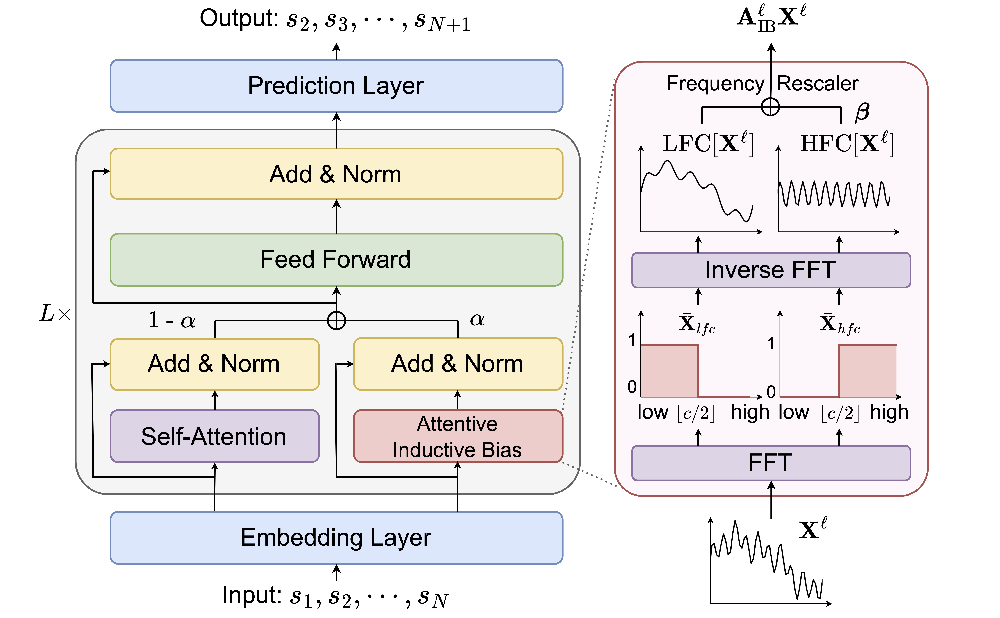

# Reproducing BSARec on LastFM (CMPE 257 Final Project)

This repository is a reproduction study of **BSARec** (Shin et al., "An Attentive Inductive Bias for Sequential Recommendation beyond the Self-Attention," AAAI 2024).

## Relationship to the original code

- Built on the authors' official implementation: https://github.com/yehjin-shin/BSARec, at commit `c80bdc0f1a889b78fe9a27e2058389cc84caea84`.
- This is not a GitHub fork. I cloned the original repository and pushed it to this repository, so the full upstream history is preserved. **Every commit after `c80bdc0` is my work.**
- See only my commits: `git log --oneline c80bdc0..HEAD`
- See every file I changed or added: `git diff c80bdc0 HEAD --stat`
- The model implementations (`src/model/`), training framework and LastFM data file are the original authors' work.

## What I added

| Path | Purpose |
| --- | --- |
| `analysis/validate_data.py` | Checks the dataset against the paper's statistics |
| `analysis/popularity.py` | Popularity baseline (not in the original code) |
| `analysis/collect_results.py` | Collects test metrics from training logs into CSV |
| `analysis/summarize.py` | Main results table and comparison with the paper |
| `analysis/plot_ablation.py` | Alpha and c sensitivity figure |
| `analysis/groups.py` | Per-user group analysis (history length, taste, popularity) |
| `analysis/decomposition.py` | Splits BSARec's gain over SASRec into a loss effect and a Fourier-branch effect |
| `analysis/beta.py` | Learned β per layer (paper Fig. 7a) |
| `analysis/oversmoothing.py` | Layer-wise oversmoothing of SASRec vs BSARec (paper Fig. 3) |
| `analysis/oversmoothing_depth.py` | Compares the oversmoothing measures at 2, 4 and 8 layers |
| `analysis/config.py` | Repo-relative paths shared by the analysis scripts |
| `analysis/hparams.sh` | Hyperparameters used for all runs |
| `analysis/results/`, `analysis/figures/` | All results and figures used in the report |
| `analysis/predictions/` | Per-seed top-20 predictions used by the group analysis |
| `run_all.sh`, `REPRODUCE.md`, `requirements.txt` | One-command reproduction, setup and a map from each result to its file |
| `src/trainers.py` | 3-line patch: saves each user's top-20 predictions during `--do_eval` (training and scoring unchanged) |
| `src/output/*.log`, `src/output/*_LastFM_s*.pt` | Training and evaluation logs from my runs, and the checkpoints the analysis loads |

To set up the environment and rerun everything, see [REPRODUCE.md](REPRODUCE.md).

<div align=center>
<h1>An Attentive Inductive Bias for Sequential Recommendation beyond the Self-Attention</h1>


 [](https://arxiv.org/abs/2312.10325)

<div>
    <a href="https://yehjin-shin.github.io/" target="_blank">Yehjin Shin*</a>,
      <a href="https://www.jeongwhanchoi.com" target="_blank">Jeongwhan Choi*</a>,
      <a href="https://scholar.google.com/citations?user=foMLcAAAAAJ&hl=en" target="_blank">Hyowon Wi</a>,
      <a href="https://sites.google.com/view/noseong" target="_blank">Noseong Park</a>,
    <div>
     Yonsei University, South Korea
    </div>
</div>
</div>

---

This is the official PyTorch implementation of the AAAI 2024 paper "An Attentive Inductive Bias for Sequential Recommendation beyond the Self-Attention".


## Overview
Beyond Self-Attention for Sequential Recommendation (BSARec) leverages Fourier transform to strike a balance between our inductive bias and self-attention.


## Updates
- (Nov 12, 2024) add visulaization code for figure 2(b)
- (Oct 18, 2024) correct default argument for layer-specific values in FEARec
- (Oct 18, 2024) rename variables in model checkpoint
- (Oct 18, 2024) organize layer classes within each model file
- (Sep 14, 2024) add data processing code
- (Apr 20, 2024) rename variable 'beta' to 'sqrt_beta'
- (Apr 16, 2024) add visualization code for figure 3

## Dataset
In our experiments, we utilize six datasets, all stored in the `src/data` folder. 
- For the Beauty, Sports, Toys, and Yelp datasets, we employed the datasets downloaded from [this repository](https://github.com/Woeee/FMLP-Rec). 
- For ML-1M and LastFM, we processed the data according to the procedure outlined in [this code](https://github.com/RUCAIBox/CIKM2020-S3Rec/blob/master/data/data_process.py).
- The `src/data/*_same_target.npy` files are utilized for training DuoRec and FEARec, both of which incorporate contrastive learning.

## Quick Start
### Environment Setting
```
conda env create -f bsarec_env.yaml
conda activate bsarec
```

### How to train BSARec
- Note that pretrained model (.pt) and train log file (.log) will saved in `src/output`
- `train_name`: name for log file and checkpoint file
```
python main.py  --data_name [DATASET] \
                --lr [LEARNING_RATE] \
                --alpha [ALPHA] \ 
                --c [C] \
                --num_attention_heads [N_HEADS] \
                --train_name [LOG_NAME]
```
- Example for Beauty
```
python main.py  --data_name Beauty \
                --lr 0.0005 \
                --alpha 0.7 \
                --c 5 \
                --num_attention_heads 1 \
                --train_name BSARec_Beauty
```

### How to test pretrained BSARec
- Note that pretrained model (.pt file) must be in `src/output`
- `load_model`: pretrained model name without .pt
```
python main.py  --data_name [DATASET] \
                --alpha [ALPHA] \ 
                --c [C] \
                --num_attention_heads [N_HEADS] \
                --load_model [PRETRAINED_MODEL_NAME] \
                --do_eval
```
- Example for Beauty
```
python main.py  --data_name Beauty \
                --alpha 0.7 \
                --c 5 \
                --num_attention_heads 1 \
                --load_model BSARec_Beauty_best \
                --do_eval
```

### How to train the baselines
- You can easily train the baseline models used in BSARec by changing the `model_type` argument.
    - `model_type`: Caser, GRU4Rec, SASRec, BERT4Rec, FMLPRec, DuoRec, FEARec
- For the hyperparameters for the baselines, check the `parse_args()` function in `src/utils.py`.
```
python main.py  --model_type SASRec \
                --data_name Beauty \
                --num_attention_heads 1 \
                --train_name SASRec_Beauty
```

## Citation
If you find our work useful, please consider citing our paper:
```
@inproceedings{shin2024bsarec,
title={An attentive inductive bias for sequential recommendation beyond the self-attention},
author={Shin, Yehjin and Choi, Jeongwhan and Wi, Hyowon and Park, Noseong},
booktitle={Proceedings of the AAAI Conference on Artificial Intelligence},
volume={38},
number={8},
pages={8984--8992},
year={2024}
}
```

## Contact
If you have any inquiries regarding our paper or codes, feel free to reach out via email at yehjin.shin@kaist.ac.kr.

## Acknowledgement
This repository is based on [FMLP-Rec](https://github.com/Woeee/FMLP-Rec).
